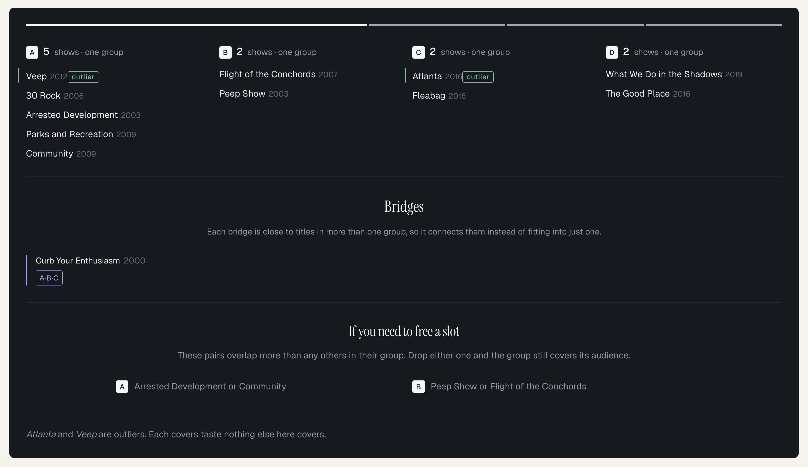

# Slate

**A lineup is not a list. It is a handful of rooms.**

Live: [https://slate-mjuq.onrender.com](https://slate-mjuq.onrender.com)

When you choose titles one at a time, several slots can end up reaching the same audience. Slate helps you build a lineup around your audience’s tastes or analyse one you already have. It shows which titles appeal to similar tastes, which bring something different, and which connect different groups.

Both paths lead to a workspace where you can explore what to keep, add or change.

Built on Qloo’s Insights API for the Qloo Agentic Hackathon 2026.



## The problem

A festival programmer reads four hundred films and picks twenty. Each film may deserve its place, but judging them individually does not show what the twenty do together. Several can appeal to the same crowd while other tastes receive little attention.

The same problem appears wherever a small lineup is chosen from a larger pool: a broadcaster filling a schedule, an airline selecting an entertainment catalogue, or a bookshop choosing a display.

Sometimes the audience is already known. A company may have survey answers or preference totals, but still needs to decide which candidates best fit those tastes within a limited number of slots.

Slate has been tested on films, music artists, books, podcasts and TV shows.

## What Slate does

### Analyse an existing lineup

Give Slate four to twenty-four titles. It asks Qloo how each one relates to the others, builds a distance between every pair, and finds the groups.

It also marks:

**Bridges.** Titles close in taste to more than one group. They connect parts of the lineup that would otherwise sit apart.

**Outliers.** Titles whose taste relationships make them stand apart from the rest. They may contribute something that the other titles do not cover.

These are interpretations of Qloo’s affinity signals, rather than measured audience sizes.

### Build for an audience

Tell Slate what your audience likes, then give it the candidates it can choose from and the number of slots available.

Audience information can come from three sources:

| Input | What to provide |
|---|---|
| Description | A written account of the audience’s tastes, including specific films, artists, books, podcasts or TV shows. |
| Survey CSV | Free-text survey answers with columns `question` and `response`. |
| Audience preferences CSV | Aggregated responses with columns `name`, `liked_count` and `disliked_count`. |

Slate extracts the named references and resolves them through Qloo. Before continuing, you can review what it understood and remove references you do not want used. Unresolved references and names mentioned only negatively are excluded from the positive interests used for selection.

Audience references can span media types. For example, an audience’s interest in musical artists and books can help inform a film selection through Qloo’s cross-domain affinities.

The candidate pool can also contain different types. Slate groups the matched candidates by type, and you choose one type for the final lineup. The selected lineup contains **4–24 titles**, depending on the number of suitable candidates available.

Choose how Slate should select:

- **Balanced:** Give different tastes equal consideration, so less common tastes receive as much consideration as popular ones.
- **Demand-led:** Prioritise preferences with the strongest support, so popular tastes have more influence on the lineup.

Balanced scores each reference by its best match in the selected lineup, with equal weight per reference. Demand-led adds the selected titles’ affinities for each reference, weighted by its positive support. The original support counts remain available as evidence in both modes.

These modes guide which titles are selected. Slate then clusters the chosen lineup to show its structure. The dashboard’s four refinement actions assess lineup structure; they do not rerun the initial audience-selection objective.

### Refine either lineup

Both entry paths lead to the same dashboard, where you can ask four things:

#### Fit it into fewer slots

Reduce the number of slots and find the best set to keep.

#### Find a title that adds a new group

Look for a new title that reaches a group the lineup is missing.

#### Check a new title against the lineup

Propose a title and see where it sits and what it changes.

#### Compare titles before adding

Compare several candidates and see which set does most for the lineup.

Each action gives you a brief you can download.

You can also lock titles that must remain. Slate respects those locks when selecting a smaller set or proposing replacements.

### Inspect the audience evidence

Workspaces built for an audience include an **Audience** tab. It brings together each audience reference and its closest match in the selected lineup, based on Qloo rankings.

The evidence shown depends on the input:

- **Description:** supporting excerpts, available by expanding a row.
- **Survey:** positive mention totals and expandable supporting excerpts.
- **Audience preferences CSV:** liked and disliked counts from the file.

References that were not used appear in a collapsed section with their reasons.

## The agent

**Find a title that adds a new group** is the agentic part. It runs up to two rounds, and each round does the same five things:

1. Looks at the lineup’s current shape.
2. Picks an unlocked title the lineup would miss least.
3. Asks Qloo for replacement candidates.
4. Tests each candidate in the full lineup and works the groups out again, so nothing is judged in isolation.
5. Keeps a swap only if the result is measurably better.

Round two starts from the lineup round one produced. If nothing clears the bar, Slate reports no change.

Every step is recorded, so you can see what it considered, what it rejected and why.

## Why Qloo

Qloo supplies the taste relationships behind both entry paths.

For lineup analysis, Slate asks about each title, sees where it ranks the others, and averages the two directions to obtain a symmetric pairwise distance. Those distances drive the grouping, bridge and outlier analysis.

For audience selection, Slate uses Qloo’s rankings between audience references and candidates. Cross-domain relationships allow references such as artists or books to inform a lineup in another supported category.

The metadata comparisons below test whether those affinity signals capture information that shared genres, release years and popularity alone miss.

## Where DeepSeek fits

Slate uses DeepSeek to read audience descriptions and free-text survey answers. It extracts explicitly named references, interprets positive and negative mentions, and retains supporting excerpts from the source.

Qloo then resolves the references and provides the affinity rankings used for selection and clustering.

Aggregated preference CSV names and counts are parsed directly. In the current implementation, DeepSeek also suggests a media type for each name before Qloo resolves it. The counts come from the CSV, not from the model.

## What we checked

Qloo’s rankings describe taste relationships. To compare them with independent audience behaviour, Slate used MovieLens: 32 million film ratings from GroupLens at the University of Minnesota.

**Group separation.** Slate tested two lineups with sufficient MovieLens coverage, evaluating 11 films in one and 12 in the other. The 23 pairs within groups averaged 0.35 on the co-rating association measure, compared with 0.24 for the 98 pairs across groups: 121 pairs in total. Slate randomly moved films between groups, keeping the same number of films in each group, and measured again ten thousand times. None produced a gap as large as Slate’s.

**Distance and audience overlap.** Across 55 film pairs, Slate’s distance had a Spearman correlation of −0.650 with co-rating association (phi). For comparison, the number of MovieLens ratings for the less-rated film in each pair scored +0.251, and release-year difference scored −0.596. Slate’s distance showed the strongest absolute relationship among these three comparisons. These measurements concern which users rated both films, rather than whether they liked them.

**Comparison with metadata.** On the same 55 pairs, Slate’s distance had a correlation of −0.498 with rating agreement. Shared genres scored +0.038, release-year difference −0.139, and the difference in Qloo popularity scores +0.060. Shared genres uses Jaccard similarity between the complete genre sets. Slate’s distance showed the strongest absolute association among these measures on this sample.

**Stability when a title leaves.** Removing one title at a time, reranking the stored Qloo results and repeating the grouping produced adjusted Rand index scores of approximately 0.97, 0.86, 0.76 and 0.74 across four sample lineups. A score of 1 means identical groupings; around 0 means chance-level agreement. Negative scores are possible.

**Bridge centrality and popularity.** Across 62 films, structural centrality had a pooled correlation of +0.08 with Qloo popularity. The relationship varies by lineup: two correlations are positive and two negative. Popularity alone does not earn the bridge label; the title must also pass Slate’s structural checks.

These checks are reproducible from `scripts/`. The site’s evidence section presents the measurements and methods. They assess Slate’s film distances, grouping and stability. Audience-guided selection uses those affinity signals to build around the preferences supplied by the user.

## Honest limits

- Affinity is not attendance, revenue, purchase intent or a count of people reached.
- Bridge and outlier interpretations are inferences from taste relationships.
- Survey mentions do not necessarily represent unique respondents. A written description does not establish audience sizes or precise levels of support.
- Aggregated counts describe responses per item. They do not establish separate customer groups or reveal which preferences belong to the same people.
- Negative-only references are excluded from positive interests. This does not guarantee that similar candidates will be avoided.
- The MovieLens checks cover a limited set of films. Their results should not be assumed to hold equally across every lineup or media type.
- The final selection depends on the candidate pool, the supplied audience evidence and Qloo’s coverage.

## Running it

Requires Python 3.10 or later.

### 1. Create and activate a virtual environment

From the project directory:

```bash
python3 -m venv .venv
source .venv/bin/activate
```

### 2. Install dependencies

```bash
pip install -r requirements.txt
```

### 3. Configure your API keys

Copy the example configuration:

```bash
cp .env.example .env
```

Open `.env` and fill in your keys:

```dotenv
QLOO_BASE_URL=https://hackathon.api.qloo.com
QLOO_API_KEY=your_qloo_api_key
DEEPSEEK_API_KEY=your_deepseek_api_key
```

- **Qloo** provides entity matching and affinity rankings.
- **DeepSeek** reads audience descriptions and free-text survey answers, and suggests media types for names in aggregated preference CSVs. The existing-lineup analysis path does not require it.

The extractor defaults to `deepseek-flash`. You can override it with `DEEPSEEK_MODEL` if needed.

Keep `.env` private and out of version control. These instructions are for running your own copy; users of the hosted demo do not need to provide API keys.

### 4. Start Slate

With the virtual environment active:

```bash
python3 -m uvicorn app.main:app --reload --port 8000
```

Open [http://localhost:8000](http://localhost:8000).

The `--reload` option restarts the server when local code changes.

### Optional: warm the sample cache

To fetch and cache the sample lineup data:

```bash
python3 scripts/warm_cache.py
```

This makes live Qloo requests and stores the responses under `data/cache`. Subsequent requests can reuse those cached responses.

The supplied configuration uses Qloo’s hackathon endpoint. Use the endpoint appropriate to your API credentials.

### Workspace storage

Local workspaces use SQLite at `data/slate.db` by default.

For PostgreSQL storage, configure `DATABASE_URL` in your environment. Keep your local database when replacing frontend files.

### PDF download

PDF generation also needs Pango, which pip cannot install:

- macOS: `brew install pango`
- Ubuntu: `apt install libpango-1.0-0 libpangoft2-1.0-0`

If the server cannot generate a PDF, Slate offers browser printing of the same brief.

## Running tests

With the virtual environment active, run the full suite from the project directory:

```bash
python3 -m pytest
```

The suite currently contains **322 tests**, organised by responsibility. It includes engine checks, audience selection and parsing, workspace persistence, and assertions about the interface and documentation. It runs without Qloo or DeepSeek API keys.

To run one area:

```bash
python3 -m pytest tests/test_clustering.py
python3 -m pytest tests/test_audience.py
python3 -m pytest tests/test_audience_weighting.py
```

Shared engine fixtures live in `tests/helpers.py`. The tests are separate from the validation probes below, which use real Qloo responses and MovieLens data.

## Reproducing the evidence

The MovieLens dataset is not included in the repository. Put the extracted `ml-32m/` directory under `data/`, then run:

```bash
python3 scripts/probe_groups.py
python3 scripts/probe_overlap.py
python3 scripts/probe_movielens.py
python3 scripts/probe_stability.py
python3 scripts/probe_bridge.py
python3 scripts/probe_censoring.py
```

The three MovieLens probes write matching audits and update their results in `data/validation.json`, which the site reads. They accept only a unique normalised title and exact year, leaving unmatched or ambiguous records outside the measurement.

The stability, bridge and censoring probes print their findings for inspection. Run `python3 scripts/precompute.py` to refresh the saved sample payloads and the bridge and stability figures used by the site. These commands can make live Qloo requests when the required responses are not cached.

## Layout

```text
app/
  main.py        API routes
  audience.py    audience-guided lineup selection
  extract.py     extraction from descriptions and survey answers
  references.py  audience reference resolution and evidence
  ingest.py      input parsing
  resolve.py     entity resolution
  build.py       payloads, subset search and comparisons
  structure.py   clustering, outliers and bridges
  matrix.py      distances from Qloo rankings
  agent.py       the swap loop
  paper.py       printable briefs
  store.py       workspace persistence
  qloo.py        the Qloo API client

static/
  index.html     the landing page
  app.html       the app shell
  app.js         figures and validation evidence
  work.js        the workspace and audience workflow
  style.css      shared styles

data/
  lineups/       sample lineups
  examples/      example inputs, including audience CSVs
  cache/         cached Qloo responses
  slate.db       local workspace database

scripts/         probes and cache utilities
tests/           the test suite
```

## Licence

MIT. See [LICENSE](LICENSE).